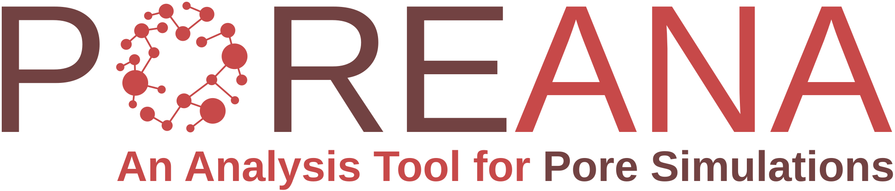

---

[](https://pypi.org/project/PoreAna/)
[](https://github.com/PoreMS/PoreAna/actions/workflows/ci.yml)
[](https://porems.github.io/PoreAna/)
[](https://github.com/PoreMS/PoreAna/actions/workflows/codeql.yml)
[](https://codecov.io/gh/PoreMS/PoreAna)
[](https://doi.org/10.5281/zenodo.4588856)
[](https://www.python.org/)
[](LICENSE)

<!-- start elevator-pitch -->

PoreAna is a Python package for analysing molecular dynamics trajectories of
nanoporous and bulk systems. Trajectories are read with
[chemfiles](https://pypi.org/project/chemfiles/), the pore geometry can be taken from
a [PoreMS](https://porems.github.io/PoreMS/) system file, and the sampled data is
stored in object files for repeated evaluation. Features include:

- **Density** profiles inside and outside the pore, mean densities, and
  adsorption as surface and volume concentration
- **Diffusion** profiles by three independent methods
    * the **bin** method of Cui
    * a **Monte Carlo** method, which also yields **free energy profiles**
    * the **velocity autocorrelation function**, axially, radially and
      tangentially per bin
- **Radius of gyration** and molecular **orientation angles**, density weighted
- Result **tables** and plotting helpers for every routine


<!-- end elevator-pitch -->

## Installation

<!-- start installation -->

PoreAna targets Python 3.12 or 3.13

```bash
python -m pip install poreana
```

To install the current development version directly from GitHub instead:

```bash
python -m pip install git+https://github.com/PoreMS/PoreAna.git
```

<!-- end installation -->

## Usage

A detailed usage guide can be found in the
[documentation](https://porems.github.io/PoreAna/). It gives further information
on

- [Sampling a trajectory](https://porems.github.io/PoreAna/sample.html)
- [Density analysis](https://porems.github.io/PoreAna/density.html)
- [Diffusion, bin method](https://porems.github.io/PoreAna/diffusion_bin.html)
- [Diffusion, Monte-Carlo method](https://porems.github.io/PoreAna/diffusion_mc.html)
- [Adsorption, radius of gyration and angle](https://porems.github.io/PoreAna/further_props.html)
- [API reference](https://porems.github.io/PoreAna/api.html)

## Development

PoreAna development takes place on GitHub:
[github.com/PoreMS/PoreAna](https://github.com/PoreMS/PoreAna). Please submit any
reproducible bugs you encounter to the
[issue tracker](https://github.com/PoreMS/PoreAna/issues).

The project uses [uv](https://docs.astral.sh/uv/) for environment and dependency

```bash
uv sync --group dev          # create the environment with the test tools
uv run pytest                # run the test suite
uv run pytest --cov          # ... with a coverage report
uv run ruff check            # lint
```

To build the documentation locally:

```bash
uv sync --group docs
uv run sphinx-build -b html docs/source docs/build
```

## Citation

If you use PoreAna in your research, please cite it using the metadata in
[`CITATION.cff`](CITATION.cff) (GitHub's "Cite this repository" button) together
with the corresponding [Zenodo DOI](https://doi.org/10.5281/zenodo.4588856) of the version you
used.

## License

This project is licensed under GPL-3.0-only.
